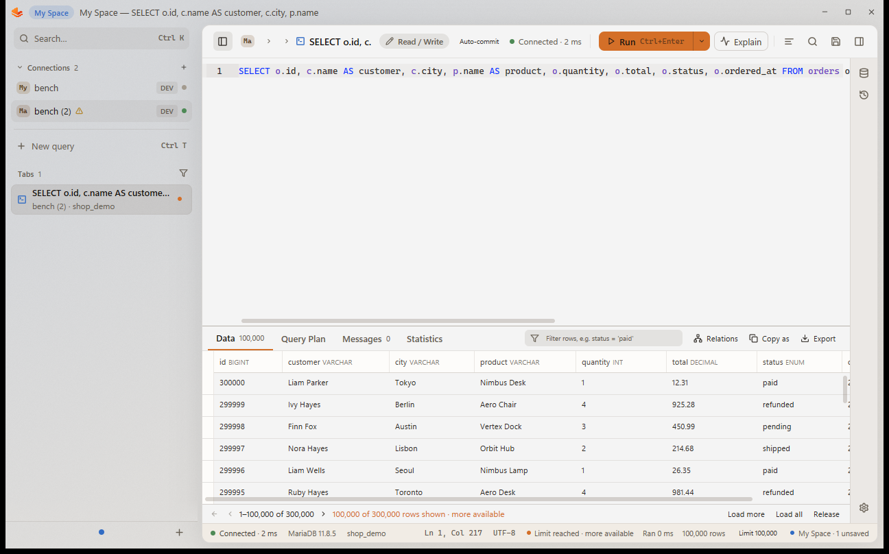
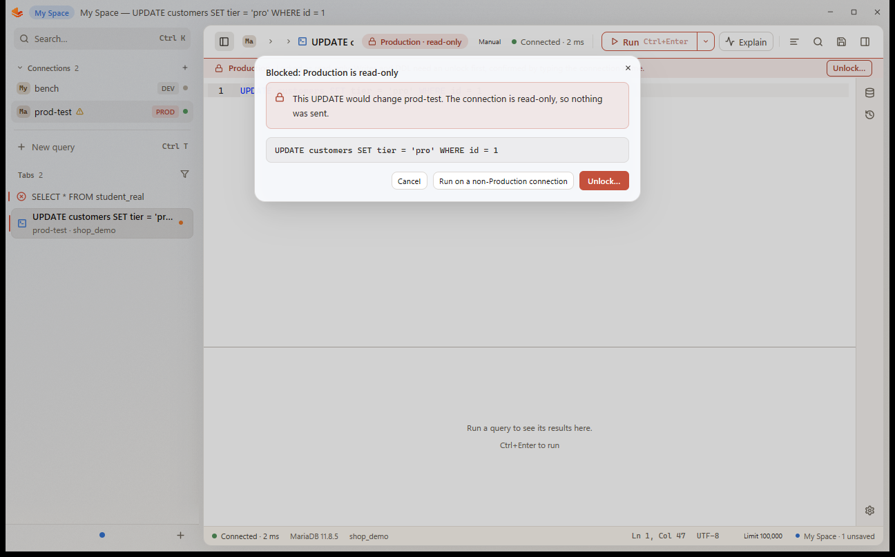
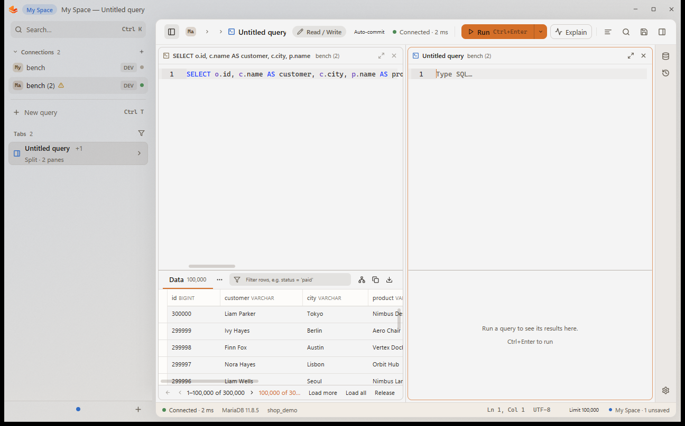
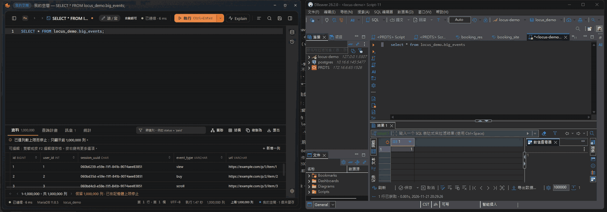

<p align="center">
  <picture>
    <source media="(prefers-color-scheme: dark)" srcset=".github/assets/logo-dark.svg">
    
  </picture>
</p>

<p align="center">
  <a href="../../releases"></a>
  <a href="../../actions/workflows/ci.yml"></a>
  
  <a href="LICENSE"></a>
</p>

<p align="center"><a href="README.md">English</a> · <b>简体中文</b> · <a href="README.zh-TW.md">繁體中文</a></p>

# Locus

Windows 上不卡顿的数据库工具。GPU 渲染、Rust 编写、一个小小的可执行文件。

Locus 支持 MySQL / MariaDB、PostgreSQL、SQLite、Redis、Oracle 和 SQL Server。查询还在运行时，结果就已经流式显示在表格里；取消查询会真正让服务器停止。

<p align="center">
  <picture>
    <source media="(prefers-color-scheme: dark)" srcset=".github/assets/screenshots/hero-dark.png">
    
  </picture>
</p>

<table>
  <tr>
    <td width="50%">
      <picture>
        <source media="(prefers-color-scheme: dark)" srcset=".github/assets/screenshots/prod-dark.png">
        
      </picture>
    </td>
    <td width="50%">
      <picture>
        <source media="(prefers-color-scheme: dark)" srcset=".github/assets/screenshots/split-dark.png">
        
      </picture>
    </td>
  </tr>
</table>

## 为什么用 Locus

- **不会卡住。** 大型结果流式载入虚拟化的表格。查询很慢或数据表很大，都不会影响输入、滚动或切换标签页。
- **对生产环境很谨慎。** 标记为 Production 的连接默认只读。要写入必须限时解锁，每一条写入语句都要单独确认，并留下审计日志。
- **不碍事。** 一个窗口、垂直标签页、分屏窗格，其余功能交给命令面板。

## 功能

**工作区**
- Space：把连接和标签页分组，每个 Space 有自己的颜色
- 垂直标签页；工作区最多分成 4 格（`Ctrl+Shift+M` 临时放大其中一格）
- 命令面板（`Ctrl+K`）、查询历史、浅色 / 深色 / 跟随系统主题、English、简体中文与繁體中文

**连接**
- MySQL / MariaDB、PostgreSQL、SQLite、SQL Server、Redis 由 Rust 直接连接；Oracle 通过一个小型 Go 辅助程序（`sidecar.exe`，已内置于 `locus.exe`）
- SSH 隧道；密码保存在 Windows 凭据管理器
- Production 保护：默认只读、限时解锁、审计日志

**查询**
- SQL 编辑器：语法高亮、查找 / 替换、格式化、补全，并根据外键建议 JOIN
- 查询参数、已保存的查询与代码片段
- 自动提交或手动事务（Commit / Rollback）
- 执行计划

**结果**
- 流式表格、服务器端取消、筛选、选区统计
- 沿着外键跳转到被引用的数据行
- 直接编辑单元格，更改在事务中应用
- 值查看器：文本、JSON 树、十六进制、图片

**对象**
- 对象树：支持分页、服务器端搜索
- 表结构标签页、关系图
- 存储过程、函数、触发器与 Oracle package 的源码与编译

**导入与导出**
- 导入 CSV 与 Excel
- 导出 CSV、xlsx、JSON、SQL INSERT、Markdown、HTML，也能从服务器流式导出完整结果

**管理**
- 服务器活动：会话列表、终止查询、服务器变量
- Redis：key 浏览器、各类型的查看器、命令窗口

## 性能

<p align="center">
  
</p>

用 `SELECT *` 载入一张 100 万行、12 列的数据表，左边是 Locus，右边是 DBeaver 26.0.5。Locus 在数据还在传输时就开始显示，并且可以随时停止查询；GIF 是实时速度。

| | Locus | DBeaver |
|---|---|---|
| 载入 100 万行 | 1.5 到 1.7 秒（3 次） | 2.9 秒（1 次；第二次因驱动程序错误失败） |
| 空闲时内存 | 约 100 MB | 约 340 MB |
| 载入完成后内存 | 约 360 MB | 约 1.3 GB（峰值 1.4 GB） |
| 关闭结果后内存 | 几秒内降到约 107 MB | 约 1.37 GB，没有释放 |

测量条件：Intel Core i5-14400F、15.8 GB 内存、Windows 11、MariaDB 11.8.5 与程序在同一台机器上（127.0.0.1、不加密）。Locus 是 release 版，关闭了每个标签页的行数上限（设置里另有一个 100 万行的内存上限仍然有效；这张表正好是 100 万行）。DBeaver 使用默认的 1 GB 堆内存，并把 fetch size 从默认的 200 调到 1,000,000，让它一次全部载入。内存是进程的私有内存，大约每秒采样一次。两个程序是在不同时间测的，DBeaver 只测了一次，所以请把 DBeaver 那一列当作一次观察，而不是基准测试。Locus 也不是每种情况都更快：10 万行的结果两边都在一秒内完成。

## 安装

到 [Releases](../../releases) 下载：可以运行安装程序 `locus-<版本>-windows-x64-setup.exe`（安装在当前用户下、不需要管理员权限，会创建开始菜单快捷方式和卸载程序），或直接运行便携版 `locus-<版本>-windows-x64.exe`，单个文件、无需安装。已内置 Oracle 支持，不需要额外文件：第一次连接 Oracle 时，会把一个小型辅助程序解压到 `%LOCALAPPDATA%\Locus\sidecar\`。

可执行文件尚未签名，第一次运行时 SmartScreen 可能会警告。验证下载的文件：

```powershell
# 与 release 页面上的 .sha256 对比
Get-FileHash .\locus-<版本>-windows-x64.exe -Algorithm SHA256

# 用 GitHub CLI 验证构建来源
gh attestation verify .\locus-<版本>-windows-x64.exe --repo sao-coding/locus
```

设置、已保存的连接和历史都在 `%APPDATA%\Locus`。删掉这个文件夹就等于重置。Oracle 辅助程序是唯一放在它之外的文件（`%LOCALAPPDATA%\Locus\sidecar\`），想完全移除请一并删除。

## 快捷键

| 按键 | 操作 |
|---|---|
| `Ctrl+K` / `Ctrl+Shift+P` | 命令面板 |
| `Ctrl+Enter` / `Ctrl+Shift+Enter` | 执行光标所在的语句 / 整个脚本 |
| `Ctrl+E` | 显示光标所在语句的执行计划 |
| `Ctrl+S` | 保存查询 |
| `Ctrl+T` / `Ctrl+W` | 新建标签页 / 关闭标签页 |
| `Ctrl+\` / `Ctrl+Shift+\` | 向右分屏 / 向下分屏 |
| `Ctrl+Shift+M` | 临时放大当前窗格 |
| `Ctrl+1…9` | 切换 Space |
| `Ctrl+B` / `Ctrl+J` | 侧边栏 / 右侧面板 |
| `Ctrl+Shift+E` | 导出结果 |
| `Ctrl+,` | 设置 |

完整列表在设置页。

## 常见问题

**支持哪些 Windows？** 64 位的 Windows 10 和 11。

**支持哪些数据库？** MySQL、MariaDB、PostgreSQL、SQLite、Redis 和 Oracle。不支持 ClickHouse、SQL Server 或 MongoDB。

**Oracle 需要安装 Oracle Client 吗？** 不需要。辅助程序使用纯 Go 的驱动（[go-ora](https://github.com/sijms/go-ora)），什么都不用安装。

**我的密码会被发送到哪里吗？** 不会。见[隐私](#隐私)。

## 反馈问题

请提交 [issue](../../issues/new/choose)，写明连接的数据库与版本，以及你做了什么。不要贴密码或连接字符串。安全问题请看 [SECURITY.md](SECURITY.md)，不要提交公开 issue。

## 从源码构建

需要 Windows、较新的 stable Rust，以及 Go（Oracle 辅助程序用）。

```powershell
cargo build --release -p app       # target\release\locus.exe
.\sidecar\build.ps1                # sidecar\bin\sidecar.exe
cargo test --workspace --lib --bins
```

不要重新生成 `Cargo.lock`：`gpui-kit` 是某个时间点的快照，重新解析版本会导致构建失败。详见 [CONTRIBUTING.md](CONTRIBUTING.md)。源码地图在 [docs/README.md](docs/README.md)。

## 隐私

Locus 没有遥测、没有账号、没有更新检查，自己也不会产生网络流量。它只会连接你配置的数据库与 SSH 主机。密码保存到 Windows 凭据管理器，不会写入文件。查询历史和审计日志保存在你电脑的 `%APPDATA%\Locus`，结果数据不会写在那里。Locus 写入的唯一其他文件是 `%LOCALAPPDATA%\Locus\sidecar\` 里的 Oracle 辅助程序。

## 致谢

- [GPUI](https://www.gpui.rs/) 与 `gpui-kit`：界面
- [Arc](https://arc.net)：Space 与垂直标签页的设计灵感

所有内含组件的许可证见 [THIRD_PARTY_LICENSES.md](THIRD_PARTY_LICENSES.md)。

## 许可证

[AGPL-3.0](LICENSE)。
