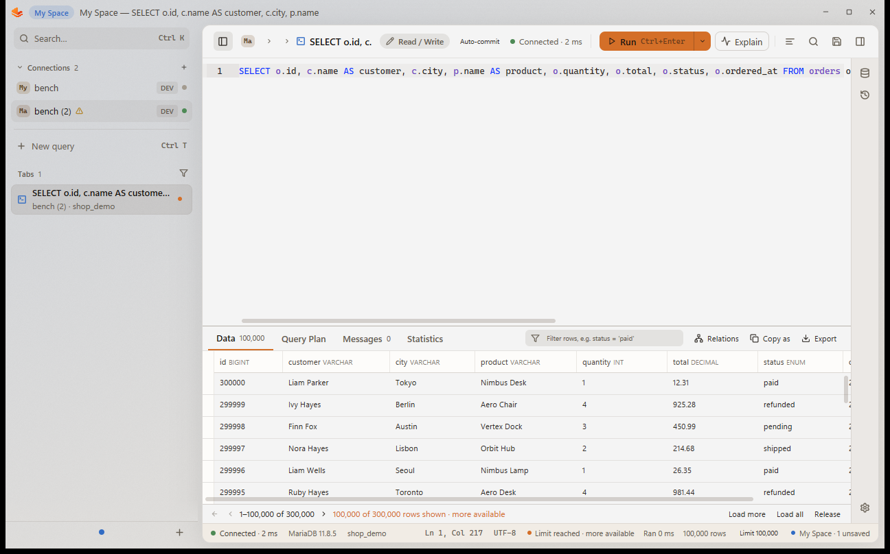
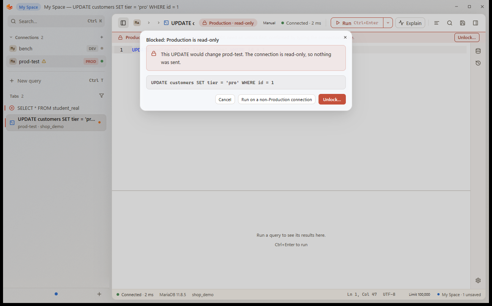
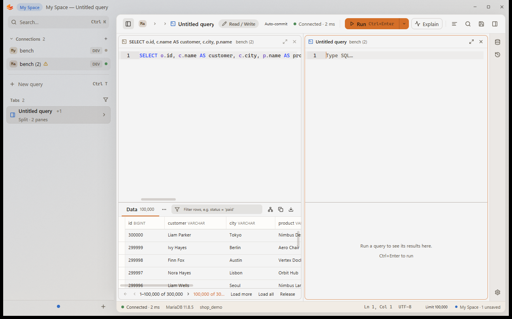
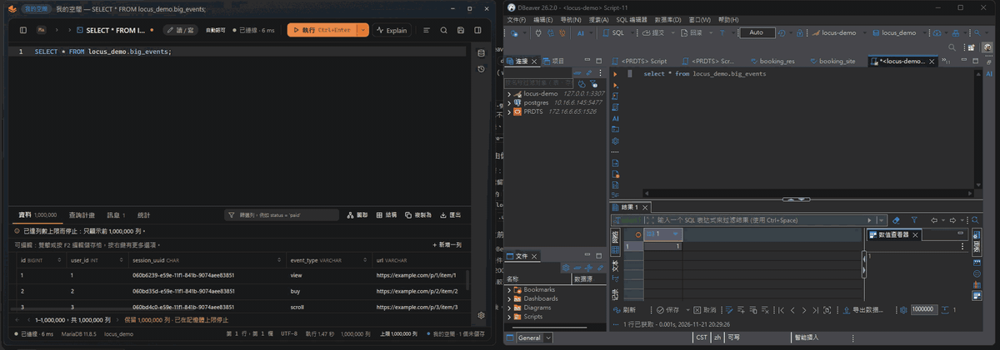

<p align="center">
  <picture>
    <source media="(prefers-color-scheme: dark)" srcset=".github/assets/logo-dark.svg">
    
  </picture>
</p>

<p align="center">
  <a href="../../releases"></a>
  <a href="../../actions/workflows/ci.yml"></a>
  
  <a href="LICENSE"></a>
</p>

<p align="center"><a href="README.md">English</a> · <a href="README.zh-CN.md">简体中文</a> · <b>繁體中文</b></p>

# Locus

Windows 上不卡頓的資料庫工具。GPU 繪製、Rust 撰寫、一個小小的執行檔。

Locus 支援 MySQL / MariaDB、PostgreSQL、SQLite、Redis 和 Oracle。查詢還在跑的時候，結果就已經串流進表格；取消查詢會真的讓伺服器停止。

<p align="center">
  <picture>
    <source media="(prefers-color-scheme: dark)" srcset=".github/assets/screenshots/hero-dark.png">
    
  </picture>
</p>

<table>
  <tr>
    <td width="50%">
      <picture>
        <source media="(prefers-color-scheme: dark)" srcset=".github/assets/screenshots/prod-dark.png">
        
      </picture>
    </td>
    <td width="50%">
      <picture>
        <source media="(prefers-color-scheme: dark)" srcset=".github/assets/screenshots/split-dark.png">
        
      </picture>
    </td>
  </tr>
</table>

## 為什麼用 Locus

- **不會卡住。** 大型結果串流進虛擬化的表格。查詢很慢或資料表很大，都不會影響打字、捲動或切換分頁。
- **對正式環境很謹慎。** 標成 Production 的連線預設唯讀。要寫入得限時解鎖，每一筆寫入的指令都要各自確認，並留下稽核紀錄。
- **不擋路。** 一個視窗、垂直分頁、分割窗格，其餘功能交給指令面板。

## 功能

**工作區**
- Space：把連線和分頁分組，每個 Space 有自己的顏色
- 垂直分頁；工作區最多分成 4 格（`Ctrl+Shift+M` 暫時放大其中一格）
- 指令面板（`Ctrl+K`）、查詢歷史、亮色 / 暗色 / 跟隨系統主題、English、简体中文與繁體中文

**連線**
- MySQL / MariaDB、PostgreSQL、SQLite、Redis 由 Rust 直接連線；Oracle 透過一個小型 Go 輔助程式（`sidecar.exe`，已內建於 `locus.exe`）
- SSH 通道；密碼存在 Windows 認證管理員
- Production 保護：預設唯讀、限時解鎖、稽核日誌

**查詢**
- SQL 編輯器：語法上色、尋找 / 取代、格式化、補全，並依外鍵建議 JOIN
- 查詢參數、已儲存的查詢與程式碼片段
- 自動 commit 或手動交易（Commit / Rollback）
- 執行計畫

**結果**
- 串流表格、伺服器端取消、篩選、選取統計
- 沿著外鍵跳到被參照的資料列
- 直接編輯儲存格，變更在交易中套用
- 值檢視器：文字、JSON 樹、十六進位、圖片

**物件**
- 物件樹：可分頁、伺服器端搜尋
- 資料表結構分頁、關聯圖
- 預存程序、函式、觸發器與 Oracle package 的原始碼與編譯

**匯入與匯出**
- 匯入 CSV 與 Excel
- 匯出 CSV、xlsx、JSON、SQL INSERT、Markdown、HTML，也能從伺服器串流匯出完整結果

**管理**
- 伺服器活動：session 列表、終止查詢、伺服器變數
- Redis：key 瀏覽器、各型別的檢視器、指令視窗

## 效能

<p align="center">
  
</p>

用 `SELECT *` 載入一張 100 萬筆、12 欄的資料表，左邊是 Locus，右邊是 DBeaver 26.0.5。Locus 在資料還在送來的時候就顯示，並且可以隨時停止查詢；GIF 是即時速度。

| | Locus | DBeaver |
|---|---|---|
| 載入 100 萬筆 | 1.5 到 1.7 秒（3 次） | 2.9 秒（1 次；第二次因驅動程式錯誤失敗） |
| 閒置時記憶體 | 約 100 MB | 約 340 MB |
| 載入完成後記憶體 | 約 360 MB | 約 1.3 GB（高峰 1.4 GB） |
| 關閉結果後記憶體 | 幾秒內降到約 107 MB | 約 1.37 GB，沒有釋放 |

量測條件：Intel Core i5-14400F、15.8 GB RAM、Windows 11、MariaDB 11.8.5 與程式在同一台機器上（127.0.0.1、不加密）。Locus 是 release 版、關閉每個分頁的列數上限（設定裡另有一個 100 萬列的記憶體上限仍然有效；這張表剛好是 100 萬列）。DBeaver 用預設的 1 GB heap，並把 fetch size 從預設的 200 調到 1,000,000，讓它一次全部載入。記憶體是程序的私有記憶體，大約每秒取樣一次。兩個程式是在不同時間量的，DBeaver 只量了一次，所以請把 DBeaver 那一欄當成一次觀察，不是基準測試。Locus 也不是每種情況都比較快：10 萬筆的結果兩邊都在一秒內完成。

## 安裝

到 [Releases](../../releases) 下載：可以執行安裝程式 `locus-<版本>-windows-x64-setup.exe`（裝在目前使用者底下、不需要系統管理員權限，會建立開始功能表捷徑和解除安裝程式），或直接執行可攜版 `locus-<版本>-windows-x64.exe`，單一檔案、不用安裝。已內建 Oracle 支援，不需要額外檔案：第一次連線 Oracle 時，會把一個小型輔助程式解壓縮到 `%LOCALAPPDATA%\Locus\sidecar\`。

執行檔尚未簽章，第一次執行時 SmartScreen 可能會警告。驗證下載的檔案：

```powershell
# 與 release 頁面上的 .sha256 比對
Get-FileHash .\locus-<版本>-windows-x64.exe -Algorithm SHA256

# 用 GitHub CLI 驗證建置來源
gh attestation verify .\locus-<版本>-windows-x64.exe --repo sao-coding/locus

# minisign 簽章（公鑰也在 repo 的 minisign.pub）
minisign -Vm .\locus-<版本>-windows-x64.exe -P RWRDNREpYa8EZ59rUGsAnTVNIMjNfUWhciyq6SgS2MpNZvMGj0yVAZ0s
```

設定、已儲存的連線和歷史都在 `%APPDATA%\Locus`。刪掉這個資料夾就等於重設。Oracle 輔助程式是唯一放在它之外的檔案（`%LOCALAPPDATA%\Locus\sidecar\`），想完全移除請一併刪除。

Locus 大約每天向 GitHub 查一次有沒有新版本（只送出 `User-Agent: Locus/<版本>`），有的話顯示在狀態列，不會自動下載任何東西。可以在「設定 › 關於」關閉。

## 快捷鍵

| 按鍵 | 動作 |
|---|---|
| `Ctrl+K` / `Ctrl+Shift+P` | 指令面板 |
| `Ctrl+Enter` / `Ctrl+Shift+Enter` | 執行游標所在的語句 / 整個腳本 |
| `Ctrl+E` | 顯示游標所在語句的執行計畫 |
| `Ctrl+S` | 儲存查詢 |
| `Ctrl+T` / `Ctrl+W` | 新增分頁 / 關閉分頁 |
| `Ctrl+\` / `Ctrl+Shift+\` | 向右分割 / 向下分割 |
| `Ctrl+Shift+M` | 暫時放大目前的窗格 |
| `Ctrl+1…9` | 切換 Space |
| `Ctrl+B` / `Ctrl+J` | 側欄 / 右側面板 |
| `Ctrl+Shift+E` | 匯出結果 |
| `Ctrl+,` | 設定 |

完整清單在設定頁。

## 常見問題

**支援哪些 Windows？** 64 位元的 Windows 10 和 11。

**支援哪些資料庫？** MySQL、MariaDB、PostgreSQL、SQLite、Redis 和 Oracle。沒有 ClickHouse、SQL Server 或 MongoDB。

**Oracle 要裝 Oracle Client 嗎？** 不用。輔助程式用純 Go 的驅動（[go-ora](https://github.com/sijms/go-ora)），什麼都不必安裝。

**我的密碼會被傳到哪裡嗎？** 不會。見[隱私](#隱私)。

## 回報問題

請開 [issue](../../issues/new/choose)，寫明連線的資料庫與版本，以及你做了什麼。不要貼密碼或連線字串。資安問題請看 [SECURITY.md](SECURITY.md)，不要開公開 issue。

## 從原始碼建置

需要 Windows、較新的 stable Rust，以及 Go（Oracle 輔助程式用）。

```powershell
cargo build --release -p app       # target\release\locus.exe
.\sidecar\build.ps1                # sidecar\bin\sidecar.exe
cargo test --workspace --lib --bins
```

不要重新產生 `Cargo.lock`：`gpui-kit` 是某個時間點的快照，重新解析版本會讓建置失敗。詳見 [CONTRIBUTING.md](CONTRIBUTING.md)。原始碼的地圖在 [docs/README.md](docs/README.md)。

## 隱私

Locus 沒有遙測、沒有帳號、沒有更新檢查，自己也不會產生網路流量。它只會連到你設定的資料庫與 SSH 主機。密碼存進 Windows 認證管理員，不會寫進檔案。查詢歷史和稽核日誌留在你電腦的 `%APPDATA%\Locus`，結果資料不會被寫在那裡。Locus 寫入的唯一其他檔案是 `%LOCALAPPDATA%\Locus\sidecar\` 裡的 Oracle 輔助程式。

## 致謝

- [GPUI](https://www.gpui.rs/) 與 `gpui-kit`：介面
- [Arc](https://arc.net)：Space 與垂直分頁的設計靈感

所有內含元件的授權見 [THIRD_PARTY_LICENSES.md](THIRD_PARTY_LICENSES.md)。

## 授權

[AGPL-3.0](LICENSE)。
